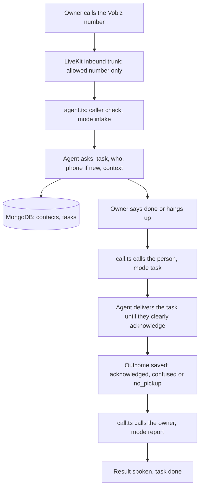

# @sunday/voice

A phone agent you give tasks by calling it. It collects the task, calls the person, and calls you back with what happened.

## Flow



Each turn the LLM answers with one JSON object (`say`, `action`, arguments) that Sarvam must match (`response_format` JSON schema in `src/schemas/`). The code speaks `say` and runs `action` from `src/tools/`.

## Run

```bash
cp .env.example .env        # fill in the values; ALLOWED_CALLER_NUMBER is your own number
docker compose up -d        # LiveKit, SIP, Redis and MongoDB
npm run dev -w @sunday/voice      # API server on :4100
npm run worker -w @sunday/voice   # voice agent worker
npm run inbound-setup -w @sunday/voice   # once, on the server: the Vobiz number answers only for ALLOWED_CALLER_NUMBER
```

Point Vobiz at LiveKit once, so calls to your number reach the agent (per [Vobiz's LiveKit guide](https://www.vobiz.ai/docs/integrations/livekit)):

```bash
# inbound_destination is your LiveKit SIP host, without the sip: prefix
curl -X PATCH https://api.vobiz.ai/api/v1/Account/{auth_id}/trunks/{trunk_id} \
  -H 'X-Auth-Token: <token>' -H 'content-type: application/json' \
  -d '{"inbound_destination":"<your-livekit-sip-host>"}'
```

Re-run a saved task's call (for example after `no_pickup`):

```bash
curl -X POST localhost:4100/calls -H 'content-type: application/json' -d '{"task_id":"<id>"}'
```

## Files

| Path | Purpose |
|---|---|
| `src/index.ts` | Express server: `POST /calls { task_id }`, `GET /health` |
| `src/call.ts` | Creates the room, sends the agent in, dials through Vobiz; a failed task dial becomes `no_pickup` |
| `src/agent.ts` | Worker: mode, caller check, runs the call, starts the next call |
| `src/call-agent.ts` | One turn: ask Sarvam, speak `say`, run the action |
| `src/session.ts` | VAD, STT and TTS from `src/config/voice.config.ts` (Niva defaults, `bulbul:v4-flash`) |
| `src/schemas/` | The JSON schema of each turn, and the phone check |
| `src/tools/` | One file per action the agent can take |
| `src/prompts/` | The base, intake and task prompts, and the spoken report |
| `src/models/`, `src/services/` | `contacts` and `tasks` in MongoDB |
| `scripts/inbound-setup.ts` | Creates the inbound trunk and dispatch rule |

## Limitations

- Vobiz trial numbers are outbound-only; inbound needs a KYC-verified account and a dedicated number.
- Inbound needs LiveKit SIP and the worker on a public server; Vobiz cannot reach a laptop.
- Caller ID is the only check on who is calling in, and it can be spoofed.
- `@livekit/agents-plugin-sarvam@1.10.0` has no `bulbul:v4-flash` types, so the model is cast; it does not send `temperature` for v4.
- The voice settings are a copy of Circuit's Niva defaults; change them in `src/config/voice.config.ts`.
