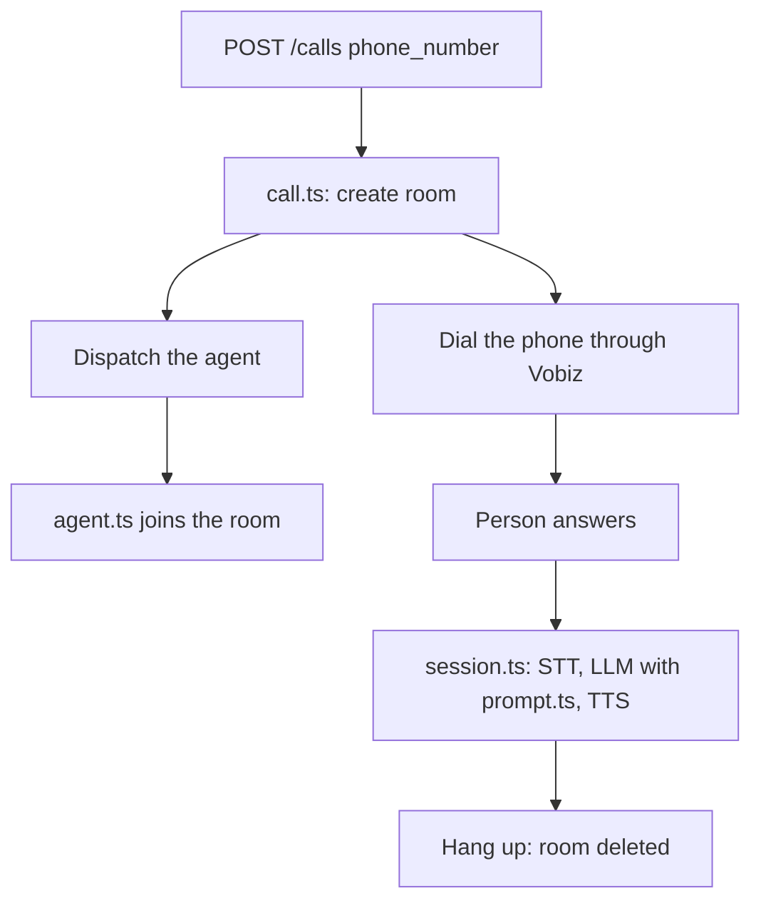

# @sunday/voice

A phone-call voice bot that runs on one prompt. It calls a number through a Vobiz SIP trunk and LiveKit, then talks with Sarvam speech-to-text, an LLM and text-to-speech.

## Flow



## Run

```bash
cp .env.example .env        # fill in the Sarvam and Vobiz values
docker compose up -d        # LiveKit, SIP and Redis
npm run dev -w @sunday/voice      # API server on :4100
npm run worker -w @sunday/voice   # voice agent worker
curl -X POST localhost:4100/calls -H 'content-type: application/json' -d '{"phone_number":"+919876543210"}'
```

## Files

| File | Purpose |
|---|---|
| `src/prompt.ts` | The single system prompt and the opening instruction |
| `src/index.ts` | Express server: `POST /calls`, `GET /health` |
| `src/call.ts` | Creates the room, sends the agent in, dials through Vobiz |
| `src/agent.ts` | Worker: joins the room, speaks first, runs the call |
| `src/session.ts` | VAD, STT, LLM and TTS setup |
| `src/env.ts` | Reads and checks env values |

## Limitations

- Outbound calls only. Inbound needs a LiveKit SIP dispatch rule.
- No database, call log or transcript is saved.
- One prompt for the whole call; there are no conversation states.
