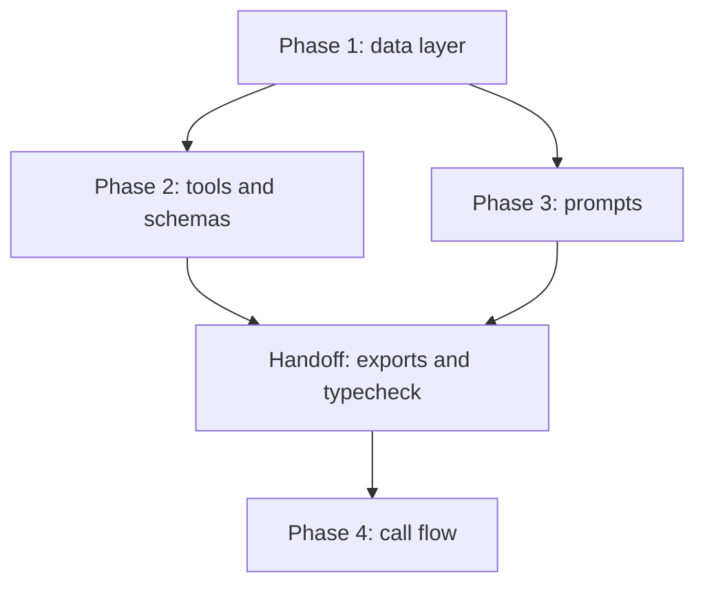
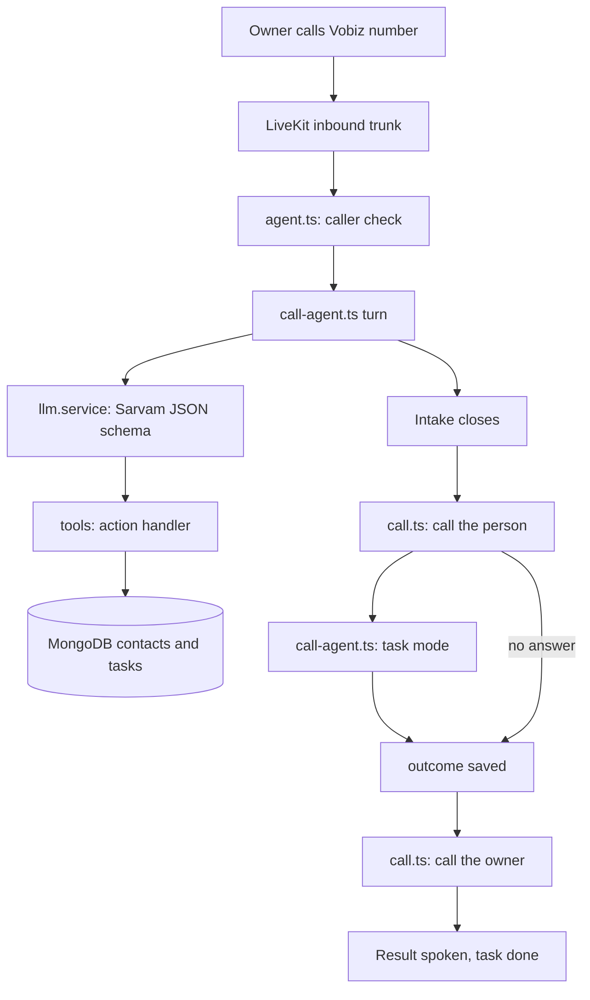

# Outbound task agent

## 1. Goal and repositories

Call Sunday from one allowed phone number and give it a task. It collects who to call, their number and any context, hangs up, calls that person, does the task, records the outcome, and calls you back with the result. The agent chooses its own next step each turn; there is no fixed state machine.

| Repository | Ownership |
|---|---|
| `sunday` | Owner. Everything is built in `apps/voice`. |
| `circuit` | Reference only. The `response_format` JSON-schema turn pattern and the Niva voice settings were copied. Sunday has no runtime link to it. |

## 2. Functional features

- Answer inbound calls only from `ALLOWED_CALLER_NUMBER`; reject every other number.
- Run the agent on schema-constrained JSON actions (Sarvam `response_format` JSON schema).
- Collect the task, who to call, their phone number (only if not in contacts) and optional context.
- Save a new number to contacts when the owner gives one.
- Ask "are you done?", say thanks, and hang up. A hang-up counts as done.
- After intake closes with a saved task, call the person and do the task.
- Record the outcome: `acknowledged`, `confused` or `no_pickup`.
- Call the owner back with the result.
- Save each task with its context, transcript and outcome.

Exclusions: no passphrase, no UI, no retries beyond a manual `POST /calls`, no queue, no multi-owner support.

## 3. Models

```text
apps/voice/src/models/
├── contact.model.ts   #NEW   contacts
│     name (unique, lowercase)   #READ lookup  #WRITE new  #MODIFY phone change
│     phone (E.164, unique)
│     created_at, updated_at
│
└── task.model.ts      #NEW   tasks
      task, contact_id → contacts, phone, context (string | null)
      status   pending | calling | done                    #MODIFY
      outcome  acknowledged | confused | no_pickup | null  #MODIFY
      transcript [{ role, text, at }]                      #MODIFY on call end
      summary, created_at, completed_at
      no #DELETE
```

Database: MongoDB through mongoose.

## 4. File tree

```text
sunday/
├── plans/outbound-task-agent.md       #NEW — this plan
├── docs/voice-plan.md                 #MODIFIED — no longer "no database"
└── apps/voice/
    ├── README.md                      #MODIFIED — new flow
    ├── docker-compose.yaml            #MODIFIED — add mongo
    ├── .env.example                   #MODIFIED — MONGODB_URI, ALLOWED_CALLER_NUMBER
    ├── package.json                   #MODIFIED — mongoose, openai
    ├── scripts/inbound-setup.ts       #NEW — inbound trunk (allowed number) and dispatch rule
    └── src/
        ├── env.ts                     #MODIFIED — new env values
        ├── db.ts                      #NEW — Mongo connection
        ├── config/voice.config.ts     #NEW — voice pipeline settings copied from Niva
        ├── models/                    #NEW — contact.model.ts, task.model.ts
        ├── services/
        │   ├── contact.service.ts     #NEW — find and save contacts
        │   ├── task.service.ts        #NEW — save task, outcome, transcript
        │   └── llm.service.ts         #NEW — one Sarvam turn with the JSON schema
        ├── schemas/
        │   ├── turn.schemas.ts        #NEW — JSON schema and result type per mode
        │   └── phone.schemas.ts       #NEW — E.164 check, shared by tools and /calls
        ├── tools/                     #NEW — one file per action, plus index.ts that runs the chosen action
        ├── prompts/                   #NEW — base, intake, task, report
        ├── prompt.ts                  #DELETED — replaced by prompts/
        ├── call-agent.ts              #NEW — the voice.Agent that runs a turn
        ├── agent.ts                   #MODIFIED — mode, caller check, chain the next call
        ├── call.ts                    #MODIFIED — mode and task id; failed dial → no_pickup
        ├── session.ts                 #MODIFIED — takes the Niva config
        └── index.ts                   #MODIFIED — Mongo; /calls re-runs a task
```

Differences from the discussed tree, all for simplicity:

- `call-agent.ts` and `services/llm.service.ts` are new files the turn loop needs.
- The report call is spoken from a template, not an LLM turn, so there is no report JSON schema.
- Tools are the handlers for the schema's `action` values, not native function calls.
- The intake agent is proactive: it greets, then asks for the task, the name, the number (only if not saved) and the context, one question at a time.
- On the person's call the agent re-explains the task more simply when they are unsure, up to three times, and presses for a clear "yes, understood" before it records `acknowledged`; only then `confused`.
- `askAgent` retries once when Sarvam returns broken JSON, and caps a turn at 400 tokens.

## 5. Routes

| Method | Path | Auth | Request | Success | Failures |
|---|---|---|---|---|---|
| GET | `/health` | none | none | `{ status: 200, msg }` | none |
| POST | `/intake` #NEW | none, local only | none | `{ status: 202, msg, room }` | 500 dial error |
| POST | `/calls` #MODIFIED | none, local only | `{ task_id }` | `{ status: 202, msg, room }` | 400 bad id or task already calling, 404 no task, 500 dial error |

`/intake` makes the agent call the owner for intake, so the flow works without inbound. Inbound is SIP, not HTTP. The old `{ phone_number }` body is removed.

## 6. Services

| Owner | Function | Arguments | Return | Side effects | Callers |
|---|---|---|---|---|---|
| contact.service | `findContact` | `name` | `Contact \| null` | read | lookup-contact tool |
| contact.service | `saveContact` | `name, phone` | `Contact` | upsert by name | save-contact tool |
| task.service | `saveTask` | `taskId \| undefined, task, contactId, phone, context` | `Task` | create or update | save-task tool |
| task.service | `getTask` | `taskId` | `Task \| null` | read | agent.ts, /calls |
| task.service | `markCalling` | `taskId` | `Task` | status `calling` | call.ts |
| task.service | `saveOutcome` | `taskId, outcome, summary` | `Task` | write outcome | report-outcome tool, call.ts |
| task.service | `completeTask` | `taskId, transcript` | `Task` | status `done` | agent.ts on close |
| call.ts | `startCall` | `phone, mode, taskId?` | `{ room }` | room, dispatch, dial | agent.ts, /calls |
| llm.service | `askAgent` | `mode, system, history` | turn result | one Sarvam call | call-agent.ts |

Validation: each turn is parsed with zod; phones must be E.164; names are trimmed and lowercased; a bad action argument returns a message to the LLM, which asks again. Authorization: the inbound trunk allows only `ALLOWED_CALLER_NUMBER`, and `agent.ts` compares `sip.phoneNumber` before any LLM runs. Errors: a failed turn makes the agent ask the person to repeat; a failed or unanswered dial sets `no_pickup` and calls the owner. Idempotency: `saveTask` updates the task the intake call already created; `/calls` refuses a task that is `calling`.

## 7. E2E smoke path (human-only)

```text
[Owner: allowed number] -> [Intake: task, who, phone?, context?] -> [save_task] -> [Are you done? yes]
   -> [Okay thanks, call ends] -> [Call the person] -> [Task delivered] -> [outcome saved]
   -> [Call the owner] -> [Result told, task done, transcript saved]

[Owner hangs up after save_task] -> [Task call starts]
[Owner hangs up before a complete task] -> [Nothing starts]
[Known contact] -> [No phone asked]     [New contact] -> [Phone asked, saved]
[Person confused] -> [confused]         [No answer in 60 s] -> [no_pickup]
[Other number calls in] -> [Rejected, nothing saved]
[Bad phone number] -> [Agent asks again, nothing saved]
[POST /calls { task_id }] -> [202]   [unknown task_id] -> [404]   [{ phone_number }] -> [400]
```

Executable cases, to be run by the engineer:

1. Setup: LiveKit, SIP, worker and Mongo running on the server; `inbound-setup.ts` run once. Action: call the Vobiz number from the allowed phone and give a task for a new contact. Expected: a `contacts` document, a `tasks` document in `pending`, then an outbound call to the contact.
2. Action: answer the task call and confirm. Expected: outcome `acknowledged`, status `done`, transcript saved, then a call to the owner.
3. Action: do not answer the task call. Expected: outcome `no_pickup` after about 60 s, then a call to the owner.
4. Action: call from another number. Expected: rejected, no task.
5. Action: `POST /calls` with a saved `task_id`. Expected: 202 and a new task call.

## 8. Phases and orchestration

```text
Phase 1 — Sunday voice data layer       env, db, models, services, mongo, packages
Phase 2 — Sunday voice tools            schemas/, tools/, llm.service
Phase 3 — Sunday voice prompts          prompts/, remove prompt.ts
Phase 4 — Sunday voice call flow        config, session, call-agent, agent, call, index, inbound script, docs
```

## Agent orchestration



Wave 1 is sequential (Phase 1). Wave 2 is Phases 2 and 3, parallel by file ownership (`tools/`, `schemas/`, `llm.service.ts` against `prompts/`). Wave 3 is sequential (Phase 4). Handoff from each wave 2 task: exported names and a clean `tsc --noEmit`.

## 9. Assumptions, risks, compatibility

- TTS is `bulbul:v4-flash`. `@livekit/agents-plugin-sarvam@1.10.0` does not know v4, so the options are cast and `temperature` is not sent.
- Voice settings are static copies of Niva's defaults; changing them needs a code change.
- `ALLOWED_CALLER_NUMBER` is in `.env` (`+919049122622`, assuming the +91 country code); `VOBIZ_CALLER_NUMBER` is also the inbound number.
- Credentials were copied from Circuit's `.env` into the gitignored `apps/voice/.env`; Circuit's `DB_URL` was not copied, and `MONGODB_URI` points at a local MongoDB.
- A hang-up after the person answered but before an outcome is saved as `confused` with the summary "The call ended before they confirmed."
- Sarvam's handling of the zod-generated JSON schema is only proven by a real call; this is checked on first run.
- Inbound needs LiveKit SIP and the worker on a public server; a laptop cannot receive Vobiz calls.
- Verified against the docs: LiveKit's `sip.phoneNumber` is the number an inbound call comes from, and inbound trunk `numbers`, `allowedNumbers` and the individual dispatch rule with agent dispatch work as built. Vobiz routes inbound with the trunk's `inbound_destination` set to the LiveKit SIP host, and its guide sets the trunk's allowed addresses to `0.0.0.0/0`. Sarvam documents `response_format` `json_schema` as structured output.
- Vobiz trial numbers are outbound-only; inbound needs a KYC-verified account and a dedicated number.
- Caller ID can be spoofed. The plan accepts number-only protection.
- Compatibility: the old `{ phone_number }` form of `POST /calls` is removed.

## 10. Flow diagram


